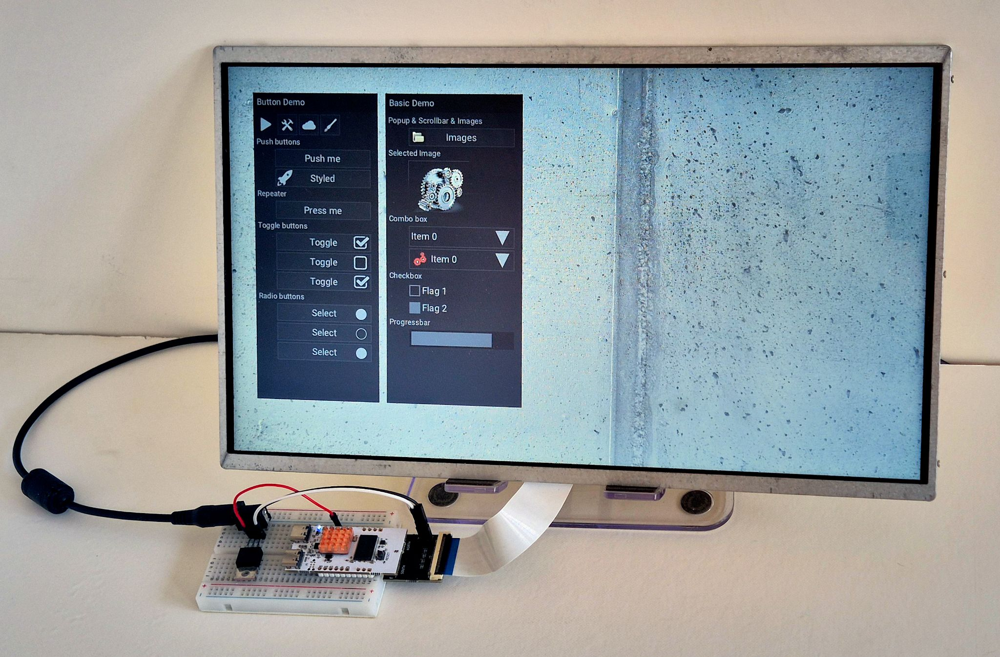

# Coming soon!

**CuprumFlow Graphics** is the missing middle ground between a plain microcontroller and a common single-board computer. It’s a pair of compact bare-metal controller boards—one CPU-based, one FPGA-based—that you can choose to drive medium and large displays (like 1366×768 or 1920×1080 resolutions) with full 24-bit color and transparency. You write graphical code "as easily as in an Arduino sketch or a MicroPython script. Put images and fonts on a microSD card, and the board handles the rest.

Swap in the right adapter and you can drive a low-cost laptop panel, a normal monitor via DVI (a signaling protocol supported on all HDMI displays), or analog VGA. USB host supports mice, keyboards and touchscreens for full HMI functionality. Everything runs completely bare-metal, keeping it lightweight, responsive, and stable in the long term.

## Just add graphics

This is aimed at devices that need a proper graphical interface but don’t need a general-purpose computer underneath: industrial and vehicle dashboards, vending machines, interactive art installations, and similar products. Will you bring the next open source oscilloscope or arcade machine?

For the technically adventurous, the FPGA version is where the CuprumFlow approach stands out. Drawing primitives -like filled rectangles, lines, alpha-blended bitmaps- are written in ordinary C-compatible source. Using a custom transpiler, that exact same source can be compiled as software for fast testing on a PC or on the small CPU board, or automatically turned into hardware accelerators on the FPGA board — no separate HDL rewrite required.

This allows you to write your graphics cores once, and run them in software or turn them into hardware. Actual testing has shown that the accelerators run several times faster than the pure software version, leaving the CPU free for application logic.

Currently working demos include generative art, simple games, an animated gear logo with anti-aliased edges, scalable fonts, widget-based UI, JPEG decoding, and hardware-accelerated video playback on some higher-end FPGA boards, which are planned. MicroPython examples that talk directly to the framebuffer have also been tested.

## Features & Specifications

<image src="images/cuprumflow-graphics-main-boards-hand.jpg" width=800>

The boards support a range of displays through swappable adapters (laptop panels over LVDS or eDP, DVI/HDMI-compatible monitors, and analog VGA). Development uses a familiar Arduino-style C++ API plus expanding MicroPython support. Assets live on a microSD card. The system runs fully bare-metal.

<image src="images/cuprumflow-graphics-adapters.jpg" width=800>

- Resolution: up to 1366×768 (current FPGA model); up to 1920×1080 (CPU model, and on the planned higher-end FPGA)
- Color: 24-bit true color with alpha (32-bit)
- Storage: microSD socket
- Outputs: laptop panels using LVDS or eDP, DVI/HDMI-compatible, analog VGA
- Languages: C++ sketches (Arduino-like) and expanding MicroPython
- USB: host and device ports (CPU board up to 480 Mbps, FPGA board USB 1.0)
- RAM: 64 / 128 / 256 MB DDR depending on model
- Board size: 50 × 26 mm

# Preview version!

This repository is a preview for the soon to be launched crowdsourcing campaign.
Software, firmware, and FPGA gateware are open source, soon to be published. Full OSHWA certification will be pursued for the hardware (schematics and production files). The project received significant funding from the [NLnet Foundation](https://nlnet.nl/) under their open-source requirements.
Unfinished features are being worked on in private repositories; the code will be fully published once comprehensive testing is complete and before the campaign ends.